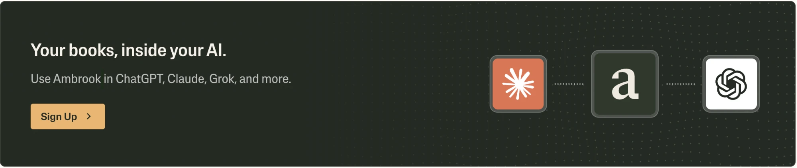

<a href="https://ambrook.com/get-started?utm_source=github&utm_medium=readme&utm_campaign=agent_plugins&utm_content=hero_banner"></a>

# Ambrook for AI assistants

Bring your [Ambrook](https://ambrook.com) books into the AI assistant you already use. The Ambrook MCP server lets Antigravity, ChatGPT, Claude, Cursor, Grok, Perplexity, and other [Model Context Protocol](https://modelcontextprotocol.io/docs/getting-started/intro) clients answer questions about your business from your live books: profit and loss, balance sheets, unpaid invoices, upcoming bills, transactions, and more.

This repository contains Ambrook's official plugins for Antigravity, Claude, ChatGPT, Cursor, and Grok, and the instructions for connecting any other MCP client.

> [!NOTE]
> The Ambrook MCP server is in beta. [Request access](https://ambrook.com/pilot) to turn it on for your account.

## What you can do

- **Close the month faster.** Compare profit and loss across months and get the biggest changes explained, using the same statement totals you see in Ambrook.
- **Stay on top of cash flow.** See what customers owe you, which invoices are overdue, and which bills are coming due.
- **Keep your books clean.** Find transactions that still need a category or enterprise tag, along with Ambrook's suggested categories.
- **Explore every part of your books.** Look up transactions, invoices, bills, estimates, contacts, accounts, reconciliations, reports, and attachments, sliced by the tags you already use.
- **Get help with Ambrook.** Search the Ambrook help center without leaving the conversation.

Every record the assistant mentions links back to its page in Ambrook, so you can open it and act in one click.

## Get started

You need an Ambrook account with the AI connection turned on. Every assistant connects to the same server:

```
https://api.ambrook.com/mcp
```

When you connect, you sign in to Ambrook and approve access. Nothing is shared until you do.

| Assistant                                                 | How to connect                                                                  |
| --------------------------------------------------------- | ------------------------------------------------------------------------------- |
| [Claude](#claude)                                         | Custom connector on claude.ai and the desktop app, or the plugin in Claude Code |
| [ChatGPT](#chatgpt)                                       | Developer mode app on chatgpt.com (paid plans)                                  |
| [Cursor](#cursor)                                         | Install the plugin from the Cursor Marketplace                                  |
| [Grok](#grok)                                             | Ask Grok Bot to add the server, or install the plugin in Grok Build             |
| [Perplexity](#perplexity)                                 | Custom connector on perplexity.ai and the Mac app                               |
| [Antigravity](#antigravity)                               | Install the plugin with the Antigravity CLI                                     |
| [Replit](#replit)                                         | Add a custom MCP server under Settings → Integrations                           |
| [Other MCP clients](#other-ai-assistants-and-mcp-clients) | VS Code, Windsurf, Codex, Gemini CLI, and any client that supports remote MCP   |

### Claude

**claude.ai and the Claude desktop app**

1. Open **Settings → Connectors**.
2. Choose **Add → Add custom connector**.
3. Enter `https://api.ambrook.com/mcp` and choose **Add**. If Claude asks for a transport, choose **Streamable HTTP**.
4. Choose **Connect**, then sign in to Ambrook and approve access.

On Team and Enterprise plans, an Owner adds the connector once under **Organization settings → Connectors**, then each member connects their own Ambrook account. To change a connection, remove the connector and add it again.

**Claude Code**

Install the plugin, which adds the server and a skill for common bookkeeping reviews:

```
/plugin marketplace add ambrook/ambrook-plugin
/plugin install ambrook@ambrook
```

Then run `/mcp`, choose `ambrook`, and sign in. See the [Claude plugin](claude-plugin/) for details.

### ChatGPT

Requires a paid ChatGPT plan (Plus, Pro, Business, Enterprise, or Edu) on chatgpt.com in a browser.

1. Open **Settings → Apps**.
2. Choose **Advanced** and turn on **Developer mode**.
3. Back on **Apps**, choose **Create**.
4. Enter the name `Ambrook`, the URL `https://api.ambrook.com/mcp`, and choose **OAuth** for authentication.
5. Choose **Create**, then sign in to Ambrook and approve access.

Start a new chat to use Ambrook. See the [ChatGPT plugin](chatgpt-plugin/) for the packaged app.

### Cursor

1. Open **Customize** in the sidebar, or browse the [Cursor Marketplace](https://cursor.com/marketplace).
2. Search for **Ambrook** and choose **Install**.
3. Under **MCP servers**, find `ambrook`, choose **Connect**, then sign in to Ambrook and approve access.

The plugin adds the server and the same bookkeeping skill. See the [Cursor plugin](cursor-plugin/) for details, including how a team admin can import this repository as a team marketplace.

### Grok

**Grok Bot**

1. Start a new chat in Grok Bot and send: `Add a custom MCP server called Ambrook at https://api.ambrook.com/mcp`
2. Check the name and URL, then choose **Add it**.
3. Choose **Authorize** on the connect card, then sign in to Ambrook and approve access.
4. Type `@` in any chat and pick **Ambrook** to use it.

Grok Bot adds MCP servers only through chat; the connectors screen on grok.com doesn't support Ambrook yet.

**Grok Build**

Install the [Grok plugin](grok-plugin/), which adds the server and the same bookkeeping skill.

### Perplexity

1. Open **Plugins** in the sidebar.
2. Choose **Add custom → Add MCP connector**, then choose **Remote**.
3. Enter the name `Ambrook` and the URL `https://api.ambrook.com/mcp`. Under **Advanced**, choose **OAuth** for authentication and **Streamable HTTP** for transport.
4. Check the acknowledgement box and choose **Add**.
5. Choose the **Ambrook** card, then sign in to Ambrook and approve access.

In an organization, an administrator adds the connector under **Organization settings → Connectors** and turns it on for members, or turns on **Allow members to add custom connectors**. See Perplexity's guide to [custom remote connectors](https://www.perplexity.ai/help-center/en/articles/13915507-adding-custom-remote-connectors) and [MCP in Perplexity](https://www.perplexity.ai/help-center/en/articles/11502712-local-and-remote-mcps-for-perplexity).

### Antigravity

Clone this repository and install the plugin with the Antigravity CLI:

```
git clone https://github.com/ambrook/ambrook-plugin.git
agy plugin install ./ambrook-plugin/antigravity-plugin
```

The first time the `ambrook` MCP server connects, sign in to Ambrook and approve access. The plugin adds the server and the same bookkeeping skill. See the [Antigravity plugin](antigravity-plugin/) for details.

### Replit

1. Open **Settings → Integrations → Your integrations**.
2. Choose **Add custom → Add personal MCP server**. To share Ambrook with your whole workspace, choose **Add workspace MCP server** instead. This needs permission to manage workspace integrations.
3. Enter `Ambrook` as the **Display name** and `https://api.ambrook.com/mcp` as the **MCP Server URL**. Leave **Advanced settings** empty.
4. Choose **Test & save**, then sign in to Ambrook and approve access.

Ambrook then appears under **MCP Servers**, and Replit Agent can use it in any of your projects. If you don't see the custom MCP options, ask your Replit workspace administrator.

### Other AI assistants and MCP clients

Any assistant that supports MCP can connect. If your client has an **Add connector** or **Add MCP server** screen, add a remote server with the URL `https://api.ambrook.com/mcp`. A browser window opens for you to sign in to Ambrook and approve access.

If your client only supports local, command-based servers, use the [`mcp-remote`](https://www.npmjs.com/package/mcp-remote) bridge (requires Node.js 18 or later):

```json
{
  "mcpServers": {
    "ambrook": {
      "command": "npx",
      "args": ["-y", "mcp-remote", "https://api.ambrook.com/mcp"]
    }
  }
}
```

## Ideas for what to ask

- "Compare my profit and loss for the last two months and explain the three biggest changes."
- "Do I have any overdue invoices or unpaid bills I should follow up on?"
- "How many transactions do I have left to tag in 2026, across both category and enterprise tags?"
- "What's my average time to payment on invoices I send compared with bills I receive?"
- "Show my 10 most recent transactions missing a category and Ambrook's suggestions for them."

Not sure where to start? Ask: "What are some interesting questions I could ask about my books?"

### Tips for better answers

- **Use exact dates.** Relative dates like "last month" can land on the wrong month or year. If results look off, ask which dates the assistant used, or name the dates yourself.
- **Let reports do the math.** Assistants can slip on long arithmetic. Ask them to work from Ambrook's reports and totals, or to write a script to process the results.

## Security and privacy

- **Read-only.** Assistants can read your books but can't create or change records, send invoices, pay bills, or move money.
- **You approve access.** The connection uses OAuth: you sign in to Ambrook and approve the read-only `external_mcp:read` scope. No credentials are stored in these plugins.
- **Scoped to your account.** Assistants see only the businesses your Ambrook account can access.
- **One endpoint.** The plugins connect only to `https://api.ambrook.com/mcp`.

See the [Ambrook Privacy Policy](https://ambrook.com/privacy) and [Terms of Service](https://ambrook.com/terms).

## Troubleshooting

| Problem                                   | What to do                                                                                                                                                            |
| ----------------------------------------- | --------------------------------------------------------------------------------------------------------------------------------------------------------------------- |
| The connection fails or says "not found"  | Your account may not have the AI connection turned on yet. [Request access](https://ambrook.com/pilot) or contact [Ambrook support](https://support.ambrook.com/en/). |
| Sign-in gets stuck                        | Make sure your browser is signed in to the right Ambrook account, then try connecting again.                                                                          |
| The assistant says it can't make a change | That's expected: the connection is read-only. Open the linked record in Ambrook to make changes.                                                                      |
| The answer uses the wrong dates           | Ask which dates the assistant used, then repeat the question with exact dates.                                                                                        |

## In this repository

| Path                                         | What it is                                                       |
| -------------------------------------------- | ---------------------------------------------------------------- |
| [`claude-plugin/`](claude-plugin/)           | Plugin for Claude Code and the Claude plugin directory           |
| [`chatgpt-plugin/`](chatgpt-plugin/)         | App package for ChatGPT                                          |
| [`cursor-plugin/`](cursor-plugin/)           | Plugin for the Cursor Marketplace                                |
| [`grok-plugin/`](grok-plugin/)               | Plugin for Grok Build                                            |
| [`antigravity-plugin/`](antigravity-plugin/) | Plugin for Antigravity                                           |
| `.claude-plugin/marketplace.json`            | Claude Code marketplace, so you can install from this repository |
| `.cursor-plugin/marketplace.json`            | Cursor marketplace, so teams can import this repository          |

Each plugin includes the `use-ambrook` skill, which guides the assistant through month-end briefings, unpaid invoices, bills due, and bookkeeping cleanup.

> [!NOTE]
> Ambrook publishes this repository automatically, and changes made here directly are overwritten. To report a problem or request a change, contact [Ambrook support](https://support.ambrook.com/en/).

## Support

- [Ambrook MCP server documentation](https://ambrook.com/mcp-server)
- [Ambrook help center](https://support.ambrook.com/en/)
- Email [support@ambrook.com](mailto:support@ambrook.com)

## License

The plugin files in this repository are licensed under the [Apache License 2.0](LICENSE). The license does not cover the Ambrook service, which is governed by the [Ambrook Terms of Service](https://ambrook.com/terms), and does not grant permission to use Ambrook's name or logos.
